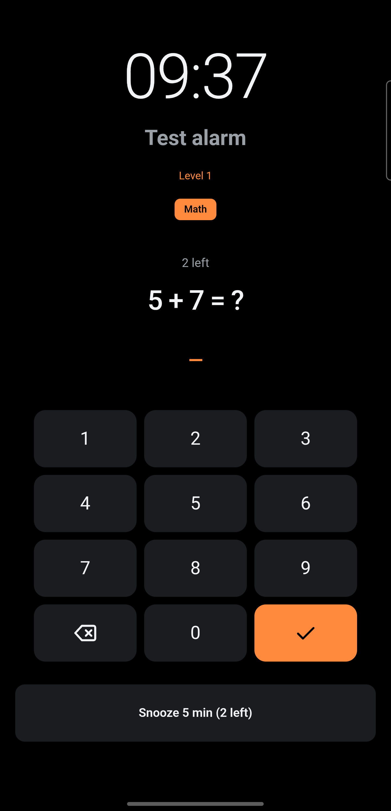
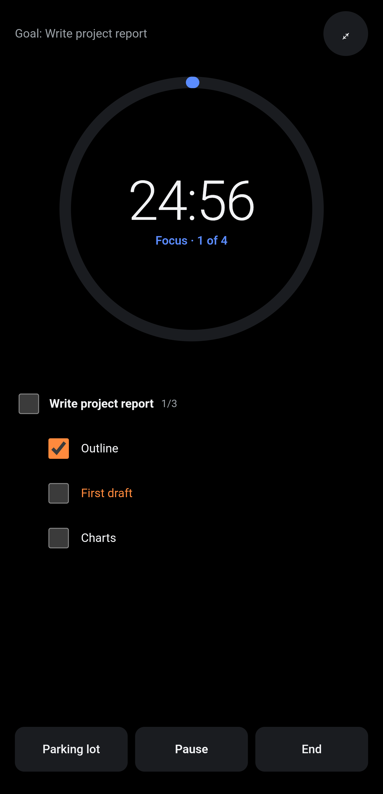
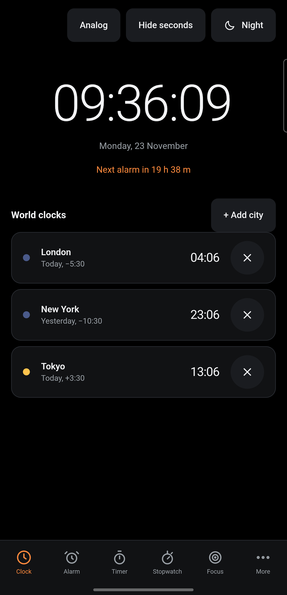
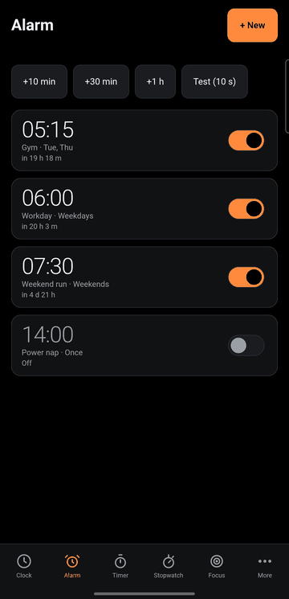
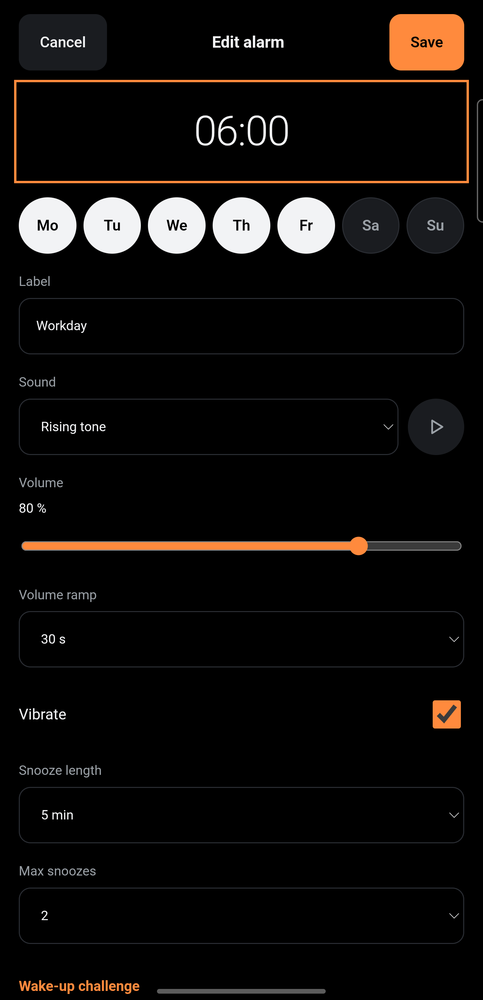
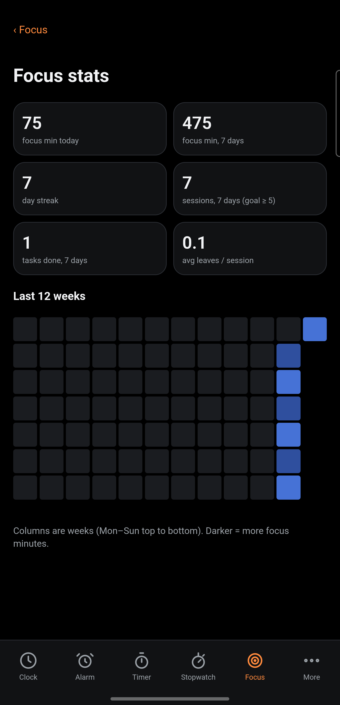
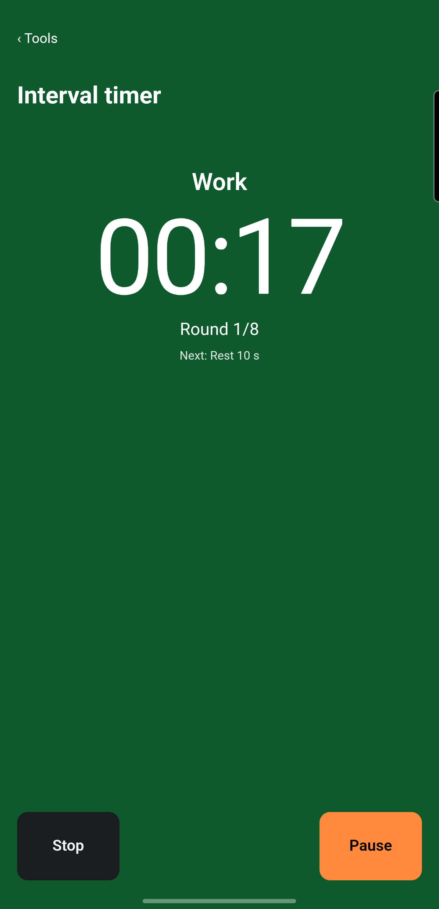
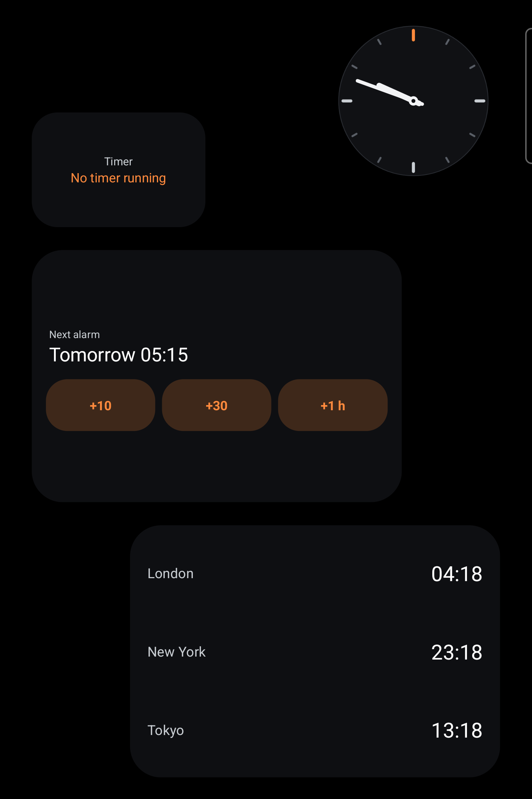
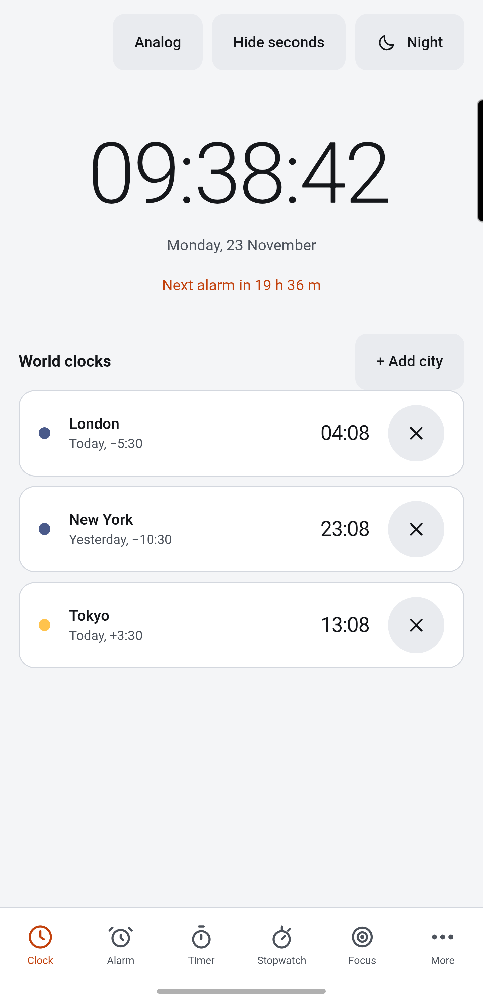

<p align="center"></p>

<p align="center">An alarm clock for Android that makes sure you actually get up, with timers, a stopwatch, focus sessions and small audio tools. Offline, no account, no ads.</p>

<p align="center">
  
  
  
  
</p>

<p align="center"></p>

## Features

**Alarm that gets you up**
- Rings on time with the phone locked, silent, on battery saver or after a restart (native Android alarms, not a web timer)
- Dismiss challenges: math, typing a phrase, memory, shaking, walking a number of steps or scanning a QR code you placed in another room. Chain up to four
- Snoozing gets harder: shorter snoozes, a harder challenge each time, a weekly snooze budget
- Wake-up check: a few minutes after you dismiss, WAKE11 asks "Are you up?". Miss it and the alarm rings again
- Gentle sunrise pre-alarm, volume ramp, nap and test alarms, an alarm log with your snoozes

**Clock, timers and focus**
- Clock with world clocks, night mode and an analog face
- Several timers at once and a stopwatch with laps. Turn the phone sideways for a big display with nine digit styles (flip clock, Nixie tubes, 7-segment and more)
- Focus sessions: Pomodoro-style blocks, a task list with subtasks, a parking lot for stray thoughts, optional Do Not Disturb and background noise, stats with streaks and a 12-week chart

**Audio Lab and tools**
- Metronome, tone generator, white/pink/brown noise, tuner, binaural beats
- Interval (HIIT/Tabata) timer, breathing guide, event countdowns, chess clock, speech timer
- Home-screen widgets: clock, analog clock, next alarm with nap buttons, timer, world clocks, countdown
- Themes: OLED black, dark, light and nine playful ones (Neon, Synthwave, Matrix, Holo, Nixie, Aurora, Mars, Blueprint, Deep Sea)

<p align="center">
  
</p>

<p align="center">
  
  
  
  
  
</p>

## Install

WAKE11 is not on the Play Store. Install the APK from GitHub:

1. Open the latest release on the [Releases page](../../releases) and download `WAKE11-<version>.apk`.
2. Optional but recommended: check the file. The release notes list its SHA-256 checksum.
   - Windows: `certutil -hashfile WAKE11-<version>.apk SHA256`
   - macOS / Linux: `shasum -a 256 WAKE11-<version>.apk`
3. Open the APK on your phone. Android asks to allow installs from your browser or file manager once; allow it, install, then you can turn that permission off again.

Updates install over the old version and keep your data, because every release is signed with the same key. Signing certificate SHA-256 fingerprint:

```
9E:B4:F1:85:CC:72:35:3E:2A:E5:A6:6E:7F:52:1C:AB:BC:2A:27:B9:F1:6E:80:42:09:6B:32:03:89:AC:CB:3D
```

To check it: `apksigner verify --print-certs WAKE11-<version>.apk` (Android SDK build-tools).

Requires Android 8.0 or newer. Tested on a Samsung Galaxy S25 Ultra with Android 17.

## First run

The setup guide takes about two minutes and ends with a real 10-second test alarm. It asks for notifications, alarms & reminders, full-screen alerts and an exemption from battery optimisation. You can run it again from More → Setup guide, and More → Reliability shows what is still missing with a Fix button for each.

Some phone makers stop background apps more aggressively than Android itself. On Samsung, also do this once:

- Settings → Battery → Background usage limits → Never sleeping apps → add WAKE11
- Settings → Apps → WAKE11 → Battery → Unrestricted

Reliability shows similar steps for other phone makers.

## Privacy

No internet permission, no analytics, no account. Everything stays on the phone and is excluded from cloud backup; Settings → Backup exports a JSON file you control. Every permission and why it is needed: [PRIVACY.md](PRIVACY.md).

## Known limitations

These device tests have not passed yet on a real phone:

- Deep Doze overnight with the phone untouched (Samsung would not enter deep Doze during the test)
- Three real nights in a row
- The full snooze sequence (3 snoozes, shorter each time); covered by unit tests, partly seen on the phone
- Power off while ringing, then ringing again after boot
- Wrong QR code three times, then the escape hatch; covered by unit tests
- Left ringing for 15 minutes, then auto-silenced and logged

## Build from source

You need Node.js (current LTS) and Android Studio (for the Android SDK and its bundled JDK).

```sh
npm ci
npm test                # unit tests (Vitest)
npm run build           # web UI → dist/
npx cap sync android    # copy it into the Android project
cd android
./gradlew installDebug  # Windows: gradlew.bat installDebug, with JAVA_HOME = Android Studio's jbr
./gradlew testDebugUnitTest
```

Release builds are signed with a key that is not in this repository. To build your own, copy `android/keystore.properties.example` to `android/keystore.properties`, point it at your keystore and run `./gradlew assembleRelease`. An APK signed with a different key cannot update the official one.

There is no browser version: the app needs the native alarm plugin and is developed and tested on a phone.

## How it is built

- Web UI: vanilla HTML, CSS and JavaScript (ES modules), bundled with Vite. No UI framework.
- Native: a small Kotlin layer under [Capacitor](https://capacitorjs.com). It owns the alarms (`AlarmManager.setAlarmClock`), wakes the phone, plays the sound and shows a native fallback screen if the web view fails.
- Time is always computed from timestamps, never counted, so timers stay right after the phone sleeps.

```
src/          web UI: core/ (bridge, store, time, icons), features/<tab>/, ring/, styles/
android/      Capacitor project; Kotlin in app/src/main/java/app/wake11/
tests/        Vitest unit tests (with a fake native plugin)
scripts/      icon generation, demo backup for screenshots
docs/         BLUEPRINT.md (design and decisions), RELEASE_PLAN.md
media/        logo and screenshots
```

## Licence and credits

WAKE11 is released under the [MIT licence](LICENSE). It includes Capacitor, Google ML Kit, qrcode-generator and the Orbitron, Rajdhani and Share Tech Mono fonts under their own licences; see [THIRD_PARTY_NOTICES.md](THIRD_PARTY_NOTICES.md).

Changes are listed in [CHANGELOG.md](CHANGELOG.md). Security problems: [SECURITY.md](SECURITY.md).
